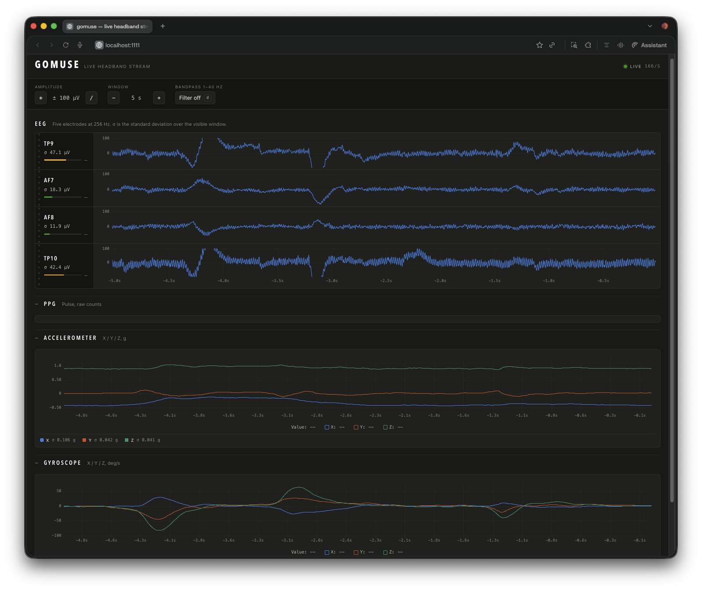

# gomuse

`gomuse` streams EEG, pulse (PPG or optics), accelerometer, and gyroscope data from a Muse
brain-sensing headband over Bluetooth Low Energy. It includes a live browser
viewer and can write each sensor stream directly to CSV, with no Python
environment, Lab Streaming Layer, or external web assets required.



## Features

- Streams EEG, pulse (PPG or optics), accelerometer, and gyroscope data over BLE
- Supports classic Muse 2 and Muse S devices, plus Muse S Athena (Gen 3)
- Serves a responsive live viewer from a single compiled binary
- Provides an optional 1–40 Hz EEG display filter
- Derives live heart rate and RMSSD heart-rate variability from the pulse stream
- Shows the headband's remaining battery percentage in the viewer
- Records one timestamped CSV file per sensor stream
- Includes a synthetic signal mode for trying the viewer without a headband
- Embeds all browser assets and requires no internet access at runtime
- Shuts down cleanly on `Ctrl-C` and flushes recordings before exiting

## Requirements

- macOS or Windows 10/11 with Bluetooth enabled
- [Go 1.24](https://go.dev/dl/) or newer
- A modern web browser
- A Muse headband, unless you use demo mode
- Optional: [Task](https://taskfile.dev/installation/) for the provided
  development commands

On macOS, real-device access uses Apple's CoreBluetooth API. The terminal
application running `gomuse` must have Bluetooth permission under **System
Settings → Privacy & Security → Bluetooth**.

On Windows, real-device access uses the WinRT Bluetooth LE interfaces, through
the same Bluetooth library as macOS. Turn Bluetooth on in **Settings →
Bluetooth & devices**. No driver or extra permission is needed, and no C
compiler: the Go toolchain alone builds it. See
[docs/WINDOWS.md](docs/WINDOWS.md) for setup, differences from macOS and a
hardware test checklist. The Windows port compiles and vets cleanly, but it has
not yet been run against a real headband; `docs/WINDOWS.md` lists what still
has to be confirmed.

## Quick start

Clone and install the command:

```sh
git clone https://github.com/itsmostafa/gomuse.git
cd gomuse
go install ./cmd/gomuse
```

Make sure your Go binary directory (`GOBIN`, or `GOPATH/bin` by default) is on
your `PATH`.

Start the viewer with synthetic signals:

```sh
gomuse stream -demo
```

Then open [http://localhost:1111](http://localhost:1111). Demo mode exercises
the same streaming, filtering, WebSocket, and rendering pipeline as a real
headband.

If Task is installed, the equivalent commands are:

```sh
task install
task demo
```

## Using a headband

Power on the headband, take it out of its case, and scan for nearby devices:

```sh
gomuse list
```

Connect to the strongest Muse found and start the viewer:

```sh
gomuse stream
```

For a predictable connection when several headbands are nearby, select one by
name or by the address printed by `list`:

```sh
gomuse stream -name MuseS-4A2B
gomuse stream -address 01234567-89AB-CDEF-0123-456789ABCDEF   # macOS
gomuse stream -address 00:55:DA:B0:12:34                      # Windows
```

On macOS the address is a UUID assigned by CoreBluetooth on the local Mac. It
is not a Bluetooth MAC address and is not portable to another computer. On
Windows it is the headband's Bluetooth MAC address, which is the same on every
computer; `AA-BB-CC-DD-EE-FF` and `AABBCCDDEEFF` are accepted as well as the
colon form.

### Supported data

| Device family | EEG | Pulse | Accelerometer | Gyroscope |
| --- | --- | --- | --- | --- |
| Muse 2 / classic Muse S | 5 channels at 256 Hz | PPG, 3 channels at 64 Hz | 3 axes at 52 Hz | 3 axes at 52 Hz |
| Muse S Athena (Gen 3) | 4 channels at 256 Hz | Optics, 16 channels at 64 Hz | 3 axes at 52 Hz | 3 axes at 52 Hz |

The two pulse streams are alternatives rather than additions: the Athena has no
PPG characteristic, and optics is its equivalent. How many of the 16 optics
channels carry signal depends on the preset — the headband sends 4, 8 or 16 of
them into the same canonical channel space, and the rest read zero.

Device generation is detected automatically from its BLE characteristics. If
a device does not expose a requested stream, `gomuse` reports what is missing
and suggests the appropriate flag for disabling it.

## Recording

Record until `Ctrl-C`:

```sh
gomuse record -dir ./data
```

Record for a fixed duration:

```sh
gomuse record -dir ./data -duration 60s
```

Driving gomuse from another program (this works on Windows, where a parent
cannot send `Ctrl-C` to a child): add `-stdin-stop`, and write the line `stop`
to gomuse's standard input when the recording should end. Closing the pipe has
the same effect, so a crashed parent does not leave a recording running. Add
`-manifest` to write `manifest.json` into the directory, listing every file with
its size, row count and SHA-256, when and why the recording stopped
(`stdin-stop`, `stdin-closed`, `duration`, `interrupt` or `source-ended`), and
the number of dropped or malformed chunks. With a real headband it also records
how the timestamps were produced: the clock they come from (the computer's wall
clock, never the headband's), the timestamp of each stream's first sample, the
sample period the fit estimated against the nominal one, and any step of the
computer's clock seen during the run:

```sh
gomuse record -dir ./data -stdin-stop -manifest
```

A parent process can also read progress without parsing the messages on standard
error: `-ready-json` writes one JSON line to standard output when the stream has
been started (`"event":"recording"`) and one when the recording ends
(`"event":"finished"`, with the stop reason and the manifest path). Both carry
`unix_us`, the computer's clock in microseconds, which is the clock of the CSV
timestamps. The first sample can follow the `recording` line by a moment; its
exact timestamp is in the manifest.

You can also view and record in the same session:

```sh
gomuse stream -record-dir ./data
```

Recordings are written as separate files because the streams have different
sample rates:

```text
data/
├── eeg_2026-07-27_14-30-00.csv
├── ppg_2026-07-27_14-30-00.csv
├── acc_2026-07-27_14-30-00.csv
└── gyro_2026-07-27_14-30-00.csv
```

Each file starts with a `timestamp` column followed by its channel names.
Timestamps are Unix seconds with microsecond precision. Sensor values use
microvolts for EEG, raw device counts for PPG, `g` for acceleration, and
degrees per second for rotation.

The viewer's EEG filter affects display data only. CSV recordings retain the
unfiltered samples.

## Command reference

```text
gomuse list [flags]
gomuse stream [flags]
gomuse record [flags]
```

Common `stream` and `record` options:

| Flag | Default | Description |
| --- | --- | --- |
| `-address ADDRESS` | scan | Connect using a peripheral address: a CoreBluetooth UUID on macOS, a Bluetooth MAC address on Windows |
| `-name NAME` | strongest device | Match an advertised device name |
| `-scan-timeout DURATION` | `10s` | Limit discovery time |
| `-preset PRESET` | automatic | Select a headband preset |
| `-disable-light` | off | Turn off the Muse S indicator light |
| `-demo` | off | Generate synthetic signals instead of using BLE |
| `-eeg=false` | enabled | Disable EEG |
| `-ppg=false` | enabled | Disable PPG (classic headbands) |
| `-optics=false` | enabled | Disable optics (Muse S Athena) |
| `-acc=false` | enabled | Disable accelerometer data |
| `-gyro=false` | enabled | Disable gyroscope data |

`stream` also accepts `-port` (default `1111`), `-record-dir`, and `-host`
(default empty, meaning every network interface; use `-host 127.0.0.1` to keep
the viewer, which has no authentication, on the local computer). `record`
accepts `-dir` (default `.`), `-duration` (default `0`, meaning until
interrupted), `-stdin-stop`, `-manifest` and `-ready-json`.

Run a command with `-h` for the complete built-in help:

```sh
gomuse stream -h
```

## Viewer controls

The browser viewer shows one trace per EEG electrode, with collapsible panels
for pulse and motion data. You can change the visible time window, adjust EEG
amplitude, and toggle the 1–40 Hz display filter from the controls or keyboard:

| Key | Action |
| --- | --- |
| `/` | Double the displayed EEG amplitude range |
| `*` | Halve the displayed EEG amplitude range |
| `+` | Lengthen the time window |
| `-` | Shorten the time window |
| `d` | Toggle the EEG display filter |

A heart-rate readout sits at the end of the display-control row whenever the
headband has a pulse sensor — PPG on a classic Muse, optics on an Athena. The
server picks whichever channel currently carries the strongest pulse, detects
beats on it, and pushes the derived rate to the viewer; the browser computes
none of it.

The readout shows a bpm figure only once the rate is locked, and a dash
otherwise, so it never displays a fabricated number. Two different situations
show that dash: no channel carries enough modulation — usually the headband is
not on properly — or one does, but too few clean beats have accumulated yet. A
locked rate is highlighted, so a provisional one still reads as provisional.
Expect a few seconds to reach a lock, and the same again after moving the
headband.

The WebSocket `pulse` message carries more than the viewer draws: RMSSD
heart-rate variability over the last 60 s (reported only after about 30 s of
beats, because it is not meaningful over less), the most recent beat-to-beat
interval, the selected channel name, and the beat timestamps themselves.

A battery indicator sits in the header, next to the connection light. Both
headband generations report their charge — an Athena in a tagged sensor block,
a classic Muse in its telemetry packet — and both send the first one only after
the stream has been running for several seconds. Until then the cell is drawn
empty with a dash beside it rather than filled in with a guess. The indicator
turns amber below 30% and red below 10%, since a headband that dies mid-session
takes the recording with it. Demo mode drains a synthetic battery far faster
than a real cell, so the readout can be watched moving without a headband.

The server also exposes `GET /healthz`, which reports its status, connected
viewer count, and dropped display chunks as JSON.

## Security and privacy

The viewer has no authentication, and the server listens on the selected port
on all network interfaces. Run it only on a trusted network or use your
firewall to restrict access. Treat CSV files as sensitive data: EEG and motion
recordings may contain personal information, and `gomuse` does not encrypt
them.

## Development

The repository has no hardware-dependent tests. Run the standard checks with
Go:

```sh
go test ./...
go vet ./...
go build ./cmd/gomuse
```

Or use the Taskfile:

```sh
task --list
task test
task test:race
task vet
task build
```

`task check` runs formatting, vetting, linting, race tests, and a build.
It requires
[golangci-lint](https://golangci-lint.run/docs/welcome/install/).
For browser development, `task dev` watches the Go and web sources and restarts
the demo viewer when they change.

The runtime is organized as one producer feeding independent consumers:

```text
Muse headband ─┐
               ├── hub ──┬── WebSocket server ── browser viewer
demo source ───┘         └── CSV recorder
```

The hub never blocks the Bluetooth callback. Each browser and recorder has its
own buffered subscription, so a slow viewer cannot stall acquisition or
another consumer.

## Contributing

Issues and pull requests are welcome. Before opening a pull request:

1. Add or update hardware-free tests for behavior changes.
2. Run `task check`, or at minimum `go test ./...`, `go vet ./...`, and a
   local build.
3. Keep changes to decoding, timestamping, or filtering aligned with
   muse-lsl, and document intentional differences.
4. Use a [Conventional Commit](https://www.conventionalcommits.org/) message,
   such as `fix(muse): handle truncated eeg packet`.

Please keep recordings and other personal biosignal data out of issues, test
fixtures, and commits unless they have been deliberately anonymized and you
have permission to share them.

## Acknowledgments

`gomuse` builds on the protocol and signal-processing work in
[muse-lsl](https://github.com/alexandrebarachant/muse-lsl). The embedded charts
use [uPlot](https://github.com/leeoniya/uPlot).

## License

This repository does not currently include a project license. Until one is
added, copyright law reserves all rights to the project authors. A license is
required before others can legally use, modify, or redistribute the code as
open source.
